# Physical-AI-Hackathon---MolomoAct2-Robotic-Arm
This Repository is related to the Physical AI Hackathon which I Participated in Oct-2026.

Team: **The Risers**. Competition: PHAIL (Positronic platform, board `molmo.competition_v2`). In stage 1 (to 15
November) a Franka robot arm in the MolmoSpaces simulator does 320 episodes: pick, pick and place, place next to, open
and close. The score is the share of episodes that the robot completes in the time limit. Stage 2 (16 November to 13
December) adds RoboLab, a second simulator with 120 table-top tasks: the total is the mean of the two scores. Up to 10
teams then run their last stage-2 image on a real Franka robot in the finale (15–17 December).

This README is a log of the work, **newest first**. The first steps (31 October) are at the bottom.
A full report of the work from image v3 to 10 November, with more pictures, is in
[`reports/2026-11-10-changes-since-v3.pdf`](reports/2026-11-10-changes-since-v3.pdf).

## Current status (17 November 2026)

| | |
|---|---|
| Best stage-1 board score | **68.4% (219/320)**, image v3 (7 November). Rank **6 of 40** on 11 November (the last rank we read) |
| Start (31 October) | 19.4% (62/320) |
| Best model | MolmoBot-Img-DROID (Ai2), half-overlap timing, left shoulder camera, 12 actions per call, 3 flow steps, still-arm rule |
| Stage-2 submission | v3-jpeg-rl2 (17 November): MolmoSpaces **65.6%** (210/320), RoboLab **0.325** (7/40 tasks fully done). Total (mean) **0.490** |
| Stage-2 image | `docker.io/denistonantony/molmobot-img-droid:v3-jpeg-rl2` |
| RoboLab | Weak half of the stage-2 score: 7 of 40 tasks done, all of them one object to one place (see 17 November) |
| Real robot | Platform check of v3: **0 of 27** episodes on 9 tasks; the public models solve 42% (see 14 November) |
| Limit | 1 submission per day |

## Score progress (newest first)

Every board submission. "Change" compares the score with our best score before that submission.

| Date (UTC) | Submission | Model and setting | Solved | Score | Change | Board rank |
|---|---|---|---|---|---|---|
| 17 Nov | `55bf0a88ba309931` | **Stage 2** (`competition.sim_stage_2`): v3-jpeg-rl2 again. RoboLab 0.325, total 0.490 | 210 | 65.6% | −2.8 | – |
| 14 Nov | `4bfca4de3f5020f4` | v3-jpeg-rl2: v3-jpeg-rl + training wording, steps of a task, deeper grasp after a miss | 214 | 66.9% | −1.6 | – |
| 13 Nov | `59db633efae52708` | v3-jpeg-rl: v3-jpeg + still-arm rule for RoboLab wordings | 212 | 66.3% | −2.2 | – |
| 11 Nov | `19a5da2d361187f1` | v3-jpeg: v3 with JPEG camera frames | 210 | 65.6% | −2.8 | – |
| 10 Nov | `49e41d2fad85b761` | v6: v5-touch with both action experts on the GPU | 208 | 65.0% | −3.4 | – |
| 9 Nov | `fdf9b9845e06f7c` | v5-touch: v5 + touch grasp for open tasks | 197 | 61.6% | −6.8 | – |
| 9 Nov | `3f52961f7f2dcab4` | v5: v4 + open pull + our open/close action expert | 215 | 67.2% | −1.2 | – |
| 8 Nov | `2e6db64841627b1e` | v3 again (the same image) | 218 | 68.1% | −0.3 | – |
| 7 Nov | `2e63188780383ff` | v4: v3 + close push + camera switch | 215 | 67.2% | −1.2 | – |
| 7 Nov | `2518efd8af2927f6` | v4-push: v3 + close push | 217 | 67.8% | −0.6 | – |
| **7 Nov** | `2a74d6b52a67c4be` | **MolmoBot-Img, 3 flow steps, still-arm rule (image v3)** | **219** | **68.4%** | **+8.4** | **2 of 33** |
| 6 Nov | `58f19b77fa0acea3` | MolmoBot-Img, 12 actions per call, 5 flow steps (image v2) | 192 | 60.0% | +12.8 | 12 of 33 |
| 5 Nov | `30b01a00181a225` | MolmoBot-Img-DROID, half overlap, left camera (image v1) | 151 | 47.2% | +6.6 | 13 of 33 |
| 5 Nov | `6571687c389055ca` | MolmoBot-DROID, half-overlap timing | 130 | 40.6% | +4.0 | 14 of 33 |
| 5 Nov | `783e6095782a813c` | MolmoBot-DROID, normal timing | 117 | 36.6% | +8.5 | 14 of 32 |
| 2 Nov | 5 runs | MolmoAct2-DROID again, the same image 5 times | 82–89 | 25.6–27.8% | −0.3 to −2.5 | 11 of 20 |
| 1 Nov | `28462ec4cc7fb2b5` | GR00T N1.7, our fine-tune (step 10000) | 66 | 20.6% | −7.5 | – |
| 31 Oct | `2d30ed2cf955a93` | MolmoAct2-DROID with the GPU fix | 90 | 28.1% | +8.7 | 10 of 15 |
| 31 Oct | `3208ed8ba648246a` | MolmoAct2-DROID, first image | – | error | – | – |
| 31 Oct | `1dd6e85f68e0c3ab` | π0.5-DROID (baseline model) | 62 | 19.4% | first | – |

The board shows the best score of each team, so a worse submission does not lower it. The rank of the team stayed 6
(of 39 and 40) after v6 and v3-jpeg.

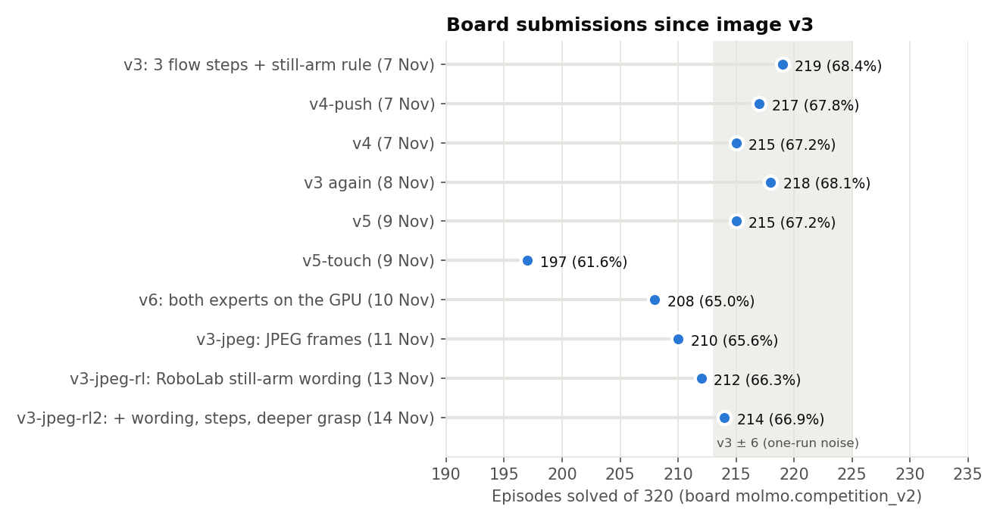

The ten submissions from v3 on are between 197 and 219. Six of them are within ±6 of v3, the noise of one board run
(see "Run-to-run noise" below).

### Successes by task type

| Task type | Episodes | v3-jpeg-rl2 (14 Nov) | v3-jpeg-rl (13 Nov) | v3-jpeg (11 Nov) | v6 (10 Nov) | v5-touch (9 Nov) | v5 (9 Nov) | v4 (7 Nov) | v4-push (7 Nov) | v3 (7 Nov) | v2 (6 Nov) | Img v1 (5 Nov) | MolmoBot (5 Nov) | MolmoAct2 (31 Oct) |
|---|---|---|---|---|---|---|---|---|---|---|---|---|---|---|
| Pick | 116 | 87 | 91 | 86 | 89 | 80 | 89 | **96** | 91 | 94 | 85 | 70 | 55 | 28 |
| Pick and place (with color) | 128 | **103** | 97 | 100 | 95 | 92 | 97 | 97 | 98 | 99 | 84 | 65 | 48 | 32 |
| Place next to | 16 | 3 | 5 | 3 | 2 | 3 | **8** | 2 | 6 | 6 | 4 | 0 | 0 | 3 |
| Open | 30 | 2 | 1 | 2 | 4 | 4 | 1 | 1 | 3 | 3 | 2 | 4 | 2 | **6** |
| Close | 30 | 19 | 18 | 19 | 18 | 18 | 20 | 19 | 19 | 17 | 17 | 12 | 12 | **21** |
| **Total** | 320 | 214 | 212 | 210 | 208 | 197 | 215 | 215 | 217 | **219** | 192 | 151 | 117 | 90 |

### Successes by task set (MolmoBot submissions)

| Set | Episodes | Time limit | v3-jpeg-rl2 | v3-jpeg-rl | v3-jpeg | v6 | v5-touch | v5 | v4 | v4-push | v3 | v2 | Img v1 |
|---|---|---|---|---|---|---|---|---|---|---|---|---|---|
| Pick, normal rooms | 59 | 31 s | 53 | **58** | 55 | 55 | 51 | 53 | 56 | 54 | 55 | 56 | 56 |
| Pick, hard | 57 | 21 s | 34 | 33 | 31 | 34 | 29 | 36 | **40** | 37 | 39 | 29 | 14 |
| Pick and place, normal rooms | 54 | 46 s | 49 | 49 | 49 | 46 | 43 | 49 | **50** | 45 | 48 | 39 | 37 |
| Pick and place, hard | 58 | 41 s | **41** | 37 | 39 | 37 | 39 | 37 | 38 | **41** | 39 | 34 | 19 |
| Pick and place, color | 16 | 41 s | **13** | 11 | 12 | 12 | 10 | 11 | 9 | 12 | 12 | 11 | 9 |
| Place next to | 16 | 31 s | 3 | 5 | 3 | 2 | 3 | **8** | 2 | 6 | 6 | 4 | 0 |
| Open, data generation | 15 | 31 s | 2 | 1 | 0 | **4** | 1 | 0 | 0 | 2 | 2 | 1 | 3 |
| Open, hard | 15 | 31 s | 0 | 0 | 2 | 0 | **3** | 1 | 1 | 1 | 1 | 1 | 1 |
| Close, data generation | 15 | 31 s | 13 | 13 | **14** | 13 | 11 | 12 | 10 | 13 | 13 | 11 | 9 |
| Close, hard | 15 | 31 s | 6 | 5 | 5 | 5 | 7 | 8 | **9** | 6 | 4 | 6 | 3 |
| **Total** | 320 | | 214 | 212 | 210 | 208 | 197 | 215 | 215 | 217 | **219** | 192 | 151 |

`risers/competition_runs/board_by_set.py` makes these counts from the `result.json` file of each submission.

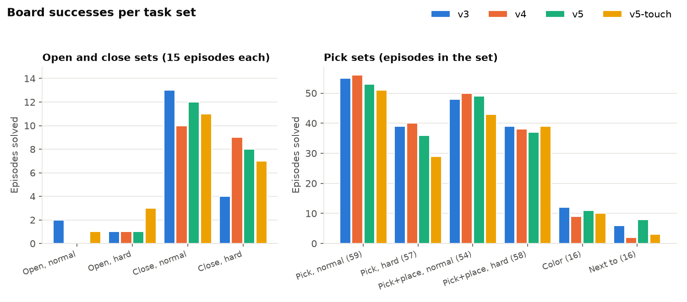

## What helped and what did not

### Changes that helped

| Date | Change | Evidence | Board gain |
|---|---|---|---|
| 31 Oct | MolmoAct2-DROID instead of π0.5 | Board: 90 against 62 | +8.7 points |
| 5 Nov | MolmoBot-DROID instead of MolmoAct2 | Local pick test 17/20 against 8/20 | +8.5 points |
| 5 Nov | Half-overlap timing (ask for the next actions while the robot moves) | Robot waits 69% instead of 73% | +4.0 points |
| 5 Nov | MolmoBot-Img-DROID (1 frame, faster) and the left shoulder camera | Local pick test 18/20 against 16/20 | +6.6 points |
| 6 Nov | Play 12 of 16 actions per call, and 5 flow steps instead of 10 | Local hard test 16/28 against 3/28 | **+12.8 points** |
| 7 Nov | Still-arm rule, and 3 flow steps instead of 5 | Local frozen test 10/19 against 4/19 | +8.4 points |
| 7 Nov | Close push rule (close tasks) | Local hard close 7/15 against 4/15. Board hard close 6 and 9 against 4 | Hard close +2 to +5. Total in the noise |
| 7 Nov | Camera switch when the left camera is blocked | Local hard close 6/15 against 4/15 (#79 solved) | About +1 |
| 9 Nov | Touch grasp (open tasks) | Local open 6/30 against 4/30. Board open 4/30, our best | Open +1 to +3. Total fell (see 9 November) |
| 10 Nov | Both action experts stay on the GPU (v6) | Model call 245 ms against 485 ms for v5-touch on a board-load test | Total 208 against 197 for v5-touch (+11). Still below v3 |
| 13 Nov | Still-arm rule for the wordings of RoboLab ("Put the X in the Y") | The rule matched 0 of 120 RoboLab tasks before, 54 after. RoboLab cloud test 0.49 → 0.51, no task worse | RoboLab only (from stage 2) |

### Changes that did not help

| Date | Change | Result |
|---|---|---|
| 31 Oct | MolmoAct2 with a shorter action horizon (0.5 s) | Practice 5/20 against 8/20 with the default. Dropped |
| 1 Nov | GR00T N1.7 fine-tuned on 1,577 of our own demos | 20.6% on the board, below MolmoAct2 (28.1%) and below untrained GR00T (25.0%) |
| 2 Nov | Submit the same MolmoAct2 image again | 5 more runs: 25.6% to 27.8%. The best stayed 28.1% |
| 5 Nov | Full-overlap timing (drop 8 of 16 actions) | Local 14/20 against 17/20 with normal timing |
| 6 Nov | Gripper rule: a closed gripper opens only when the model value is below 40 | Local 16/28, the same as without the rule |
| 7 Nov | Give the model the wording of its training data | Frozen episodes 3/19 against 2/19: no effect |
| 7 Nov | Ask the model again, use the other camera, or use 10 flow steps on a frozen arm | Probe: the arm moves at 0, 4 and 0 of 16 frozen moments |
| 7 Nov | MolmoAct2 for close tasks beside MolmoBot | Not possible: 15 GB + 10.5 GB does not fit the 24 GB board GPU |
| 8 Nov | Reword "open the X" to "pick up the X handle" | Local open 0/30 against 3/30. It removes all wins |
| 8 Nov | Open pull (pull back when the gripper holds a handle) | Local open 4/30 against 3/30: +1, in the noise. The model almost never holds a handle |
| 9 Nov | Our own open/close action expert (1,955 new demos, H100 training) | Local open 4/30 (= original expert). Board open 1/30, normal close slower |
| 9 Nov | Regrasp rule (grasp again after a close on nothing) | Local open 4/30: no gain. 72 regrasps, 1 caught something |
| 9 Nov | 10 flow steps for open and close tasks | Local open 2/30 |
| 9 Nov | Two action experts that change places on the GPU | Each change costs about 290 ms of robot time on the board. Pick tasks fell in v5 and v5-touch |
| 11 Nov | JPEG camera frames instead of raw frames | Board 210 against 219 (in the noise). Kept: a raw frame makes each call slow on a network (820 ms against 322 ms in our cloud test), and the real robot and RoboLab send three cameras |
| 12–13 Nov | FLUX 3 Action (a new public model) in the 24 GB of a board run, five settings | Best 20/40 against 26–27/40 for v3 on the same episodes. Dropped |
| 13 Nov | Late-close rule (keep the gripper open when a chunk closes it only in its last 4 actions) | 24/40 against 26–27/40. The rule acted on 2% of the calls; the gripper closed on nothing as often as before |
| 14 Nov | Training wording ("Pick up the X and place it in or on the Y") and one step at a time for tasks of several objects | RoboLab 0.36 against 0.36 (control). No failed task became a success |
| 14 Nov | Vote before a close (close only when 2 of 3 chunks close) | The other chunks agreed 215 of 223 times (board tasks) and 134 of 135 (RoboLab); the slowest calls took 510 ms instead of 200 ms. Dropped |
| 14 Nov | Deeper grasp after a miss (2 cm lower near a close on nothing) | Cloud 28/40 against 22/40 (control), but on the full board 214 against 212 without it. Kept for stage 2: it did not harm |
| 17 Nov | FLUX 3 Action with fewer denoising steps (4 → 2 → 1) | Faster calls (755 → 398 → 225 ms) but fewer successes: 20 → 18 → 16 of 40, against 26 for v3. Dropped |

### Run-to-run noise

The same behaviour gives different results in two board runs. v4-push and v3 act the same on 290 of the 320 episodes
(all but the close tasks). On those episodes v4-push solved 27 that v3 did not and lost 31 that v3 solved. A second
run of v3 gave 218 against 219. So one board run varies by about ±6 episodes (±2 points). A change must give more than
that, or we cannot see it in one run.

The cloud tests of 40 episodes vary more. On 14 November the control (the same behaviour as v3) solved 22 of 40,
where v3 solved 26 and 27 of the same 40 episodes on 10 and 11 November: ±4–5 episodes in 40. On RoboLab, one
episode per task, one task moves the mean score by 0.08.

---

## 17 November: first stage-2 score (0.490) and FLUX 3 Action with fewer denoising steps (no gain)

### Stage-2 submission: v3-jpeg-rl2

Stage 2 is one submission (`competition.sim_stage_2`) that runs both simulators; the score is the mean of the two.

| Part | Episodes | Score | Before |
|---|---|---|---|
| MolmoSpaces (`molmo.competition_v2`) | 320 | **65.6%** (210) | 66.9% (214) for the same image on 14 Nov: run-to-run noise |
| RoboLab (`robolab.competition_40`) | 40 tasks, 1 try each | **0.325** mean subtask score, 7/40 fully done | Our cloud test 0.46; platform check of v3 0.40 |
| **Total** | | **0.490** | – |

RoboLab per task (all 40 in
[`risers/tests_1117/robolab_stage2_per_task.md`](risers/tests_1117/robolab_stage2_per_task.md)):

| Kind of task | Examples | Done | Note |
|---|---|---|---|
| One object to one place | mustard in right bin, canned food in bin, butter in bin, one can packed, one more banana, reorient mug, unstack cube | **7/7 listed** | All done in 14–23 s |
| Nearly done | bananas out of bin, grab a bagel (subtask 1.0), cube behind bowl (0.67) | 0 | Last step missing |
| Several objects | all hammers, condiments, electronics, black items, red items | 0 | Some moved, then the time limit |
| Stacking or an order | stack 3 cubes, bowl on bowl, blocks in order | 0 | |
| Shelf and tools | mugs on/off shelf, pasta tool, spatula to bowl, spoons in pot | 0 | |
| Choose by description | larger object, orange object, cube or banana | 0 | |

- The model learned single pick-and-place moves; RoboLab asks for many objects, stacking and reasoning.
- The still-arm rule cut the task to its pick part 23 times in RoboLab (for example "put the black items in the bin"
  → "pick up the black items"). On tasks of several objects this may stop the robot after the first object. Not yet
  tested.

### FLUX 3 Action with fewer denoising steps

The FLUX model we run (the GD variant) does 4 denoising steps per call. We set it to 2 and 1 steps (`backend_fit.py
--num-inference-steps`) and kept the best FLUX setting of 13 November: both shoulder cameras, firm gripper, hybrid
timing, 24192 MiB GPU cap, text encoder on the CPU. Cloud test on an L40S, the same 40 episodes as before, 4 at a time
(1.6 h, $3.75). Peak GPU memory about 21 GB, no out-of-memory error.

| Group (episodes) | FLUX 4 steps | FLUX 2 steps | FLUX 1 step | FLUX best, 13 Nov | **v3 (our model)** | v3 on the board, same episodes |
|---|---|---|---|---|---|---|
| Pick, hard (14) | 3 | 3 | 4 | 4 | **10** | 14 |
| Pick and place (6) | 1 | 2 | 0 | 2 | **5** | 6 |
| Open, normal (5) | **3** | 2 | 1 | **3** | 2 | 2 |
| Open, hard (5) | **3** | 1 | 1 | 1 | 1 | 1 |
| Close, normal (5) | **5** | **5** | **5** | **5** | **5** | 4 |
| Close, hard (5) | **5** | **5** | **5** | **5** | 3 | 3 |
| **All (40)** | 20 | 18 | 16 | 20 | **26** | 30 |
| Model call, median | 755 ms | 398 ms | **225 ms** | 911 ms | 322 ms | – |

- Each step less makes a call about twice as fast, but costs successes, mostly on open tasks (6 → 3 → 2 of 10).
  Close tasks stay 10/10 at every step count.
- FLUX is better than v3 on open and close (16/20 against 11/20); v3 is far better on pick (15/20 against 4/20).
- Both models together need about 40 GB, the board gives 24 GB, so we cannot use FLUX for open/close beside v3.
- Decision: no FLUX setting beats v3; FLUX stays dropped. Full per-episode table:
  [`risers/tests_1117/results_cloud_flux_steps.md`](risers/tests_1117/results_cloud_flux_steps.md). Job:
  [`risers/cloud_job/cloud_flux_steps/`](risers/cloud_job/cloud_flux_steps/).

---

## 14 November: platform check on the real robot, rules for RoboLab and image v3-jpeg-rl2 (66.9%)

### The platform's check of v3 on a real robot and in RoboLab

On 10 November the organisers ran our best submission (v3, `2a74d6b52a67c4be`) on a real Franka arm with a Robotiq
gripper (10 tasks, 3 episodes each, 4 minutes per episode) and on 12 RoboLab tasks. This check does not change the
score or the rank, but the finale is on the real robot.

| Real robot, 9 tasks | v3 (27 episodes) | Public models (FLUX 3 Action, Cosmos 3 Nano, GR00T N1.7, Galaxea G0.5, MolmoAct2; 50 episodes) |
|---|---|---|
| Success | **0%** (0) | 42% (21) |
| Failure | 56% (15) | 30% (15) |
| Ran out of time | 44% (12) | 26% (13) |
| Safety stop | 0% | 2% (1) |

On the 10th task, "Put the marker in the bag" (no public model ran it), v3 succeeded in 1 of 3 episodes. The operator
notes: "wrong item – flat screwdriver" (marker task), "moved marker instead of toy", "moved padlock" (toy task).

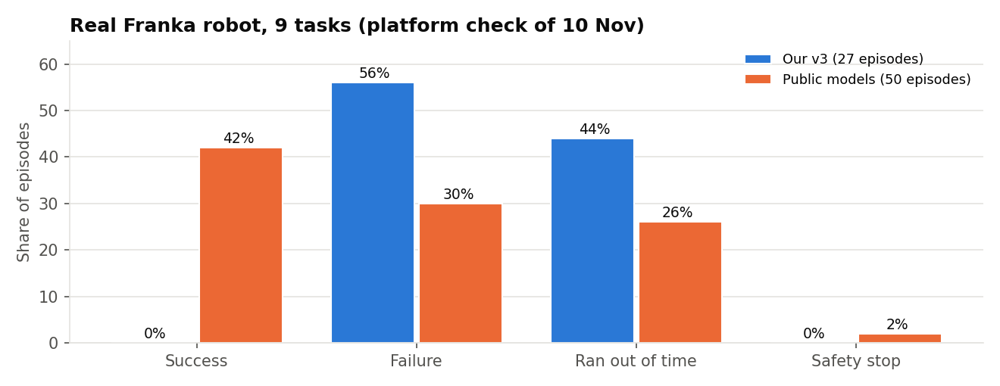

We downloaded the 30 real-robot episodes (camera videos and robot signals) and measured them:

| Measure | Real robot | RoboLab (our cloud test) | MolmoSpaces board tasks (our cloud test) |
|---|---|---|---|
| Seconds in which the commands of the model go less than 0.02 rad (the model "hesitates") | **40%** | 42% | 3% |
| Commands late (median / longest gap) | 2 ms / 0.15 s | | |
| Episodes in which the gripper never closed | 6 of 30 | | |

- **The stops are the model, not the computer.** The commands come on time, but in 40% of the seconds the model asks
  for (almost) no motion. MolmoBot learned only from simulated MolmoSpaces houses; in a scene unlike them (the real
  lab, RoboLab) it hesitates.
- **The camera choice of v3 fails on the real robot.** v3 gives the model the left shoulder camera and finds it by the
  white robot base at the lower right of the image. In the real lab the walls and the table are white, so the choice is
  near random: the same task got a different camera in different takes.

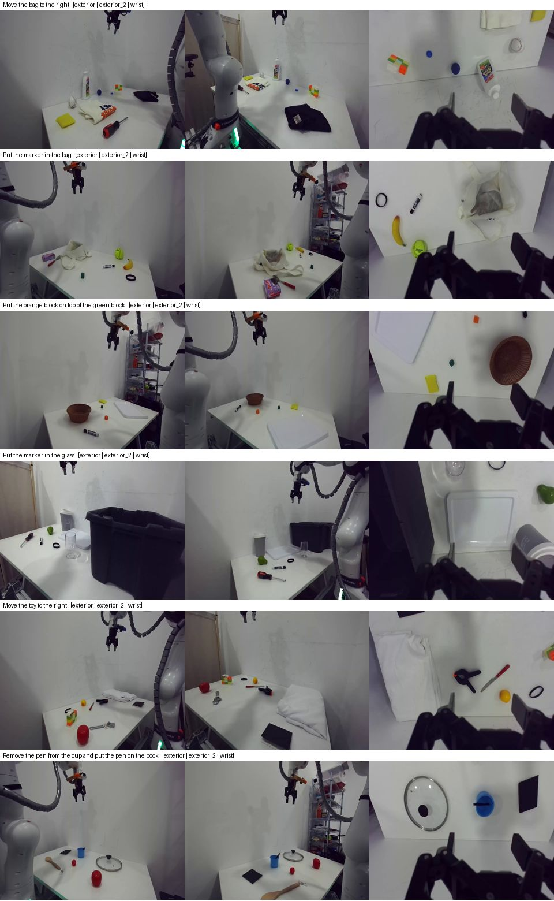

| RoboLab, 12 tasks of the platform | v3 | Public models |
|---|---|---|
| Success | 4 of 12 (33%) | 74 of 216 (34%) |
| Mean subtask score | 0.403 | 0.556 (π0.5, the baseline) |

### The study of the failures of v3

We studied all 80 episodes of the two cloud runs of v3 (10 and 11 November, the same 40 episodes) and their videos.

| Task group | Episodes | Failed | What happened in the failures |
|---|---|---|---|
| Open | 20 | 13 | 7 never held the handle, 5 held it but did not pull, 1 pulled too little |
| Pick and pick-and-place | 40 | 10 | 3 closed only on air, 3 gripped but could not lift, 4 lifted and then lost the object |
| Close | 20 | 4 | The hand stayed beside the handle and closed on nothing |

- 9 tasks failed in both runs (18 of the 27 failures): most failures repeat, they are not bad luck.
- **"Pecking":** in a failed open task the gripper closes on nothing about 14 times (every 2 s), against about 4 times
  in a success. Every failure runs to the time limit: the model never tries another way.
- Half of the closes on nothing before a grasp are more than 5 cm above the place where the gripper holds the object
  at last; the grasp that held the object was 2 cm lower than the miss before it in 19 of 24 cases.

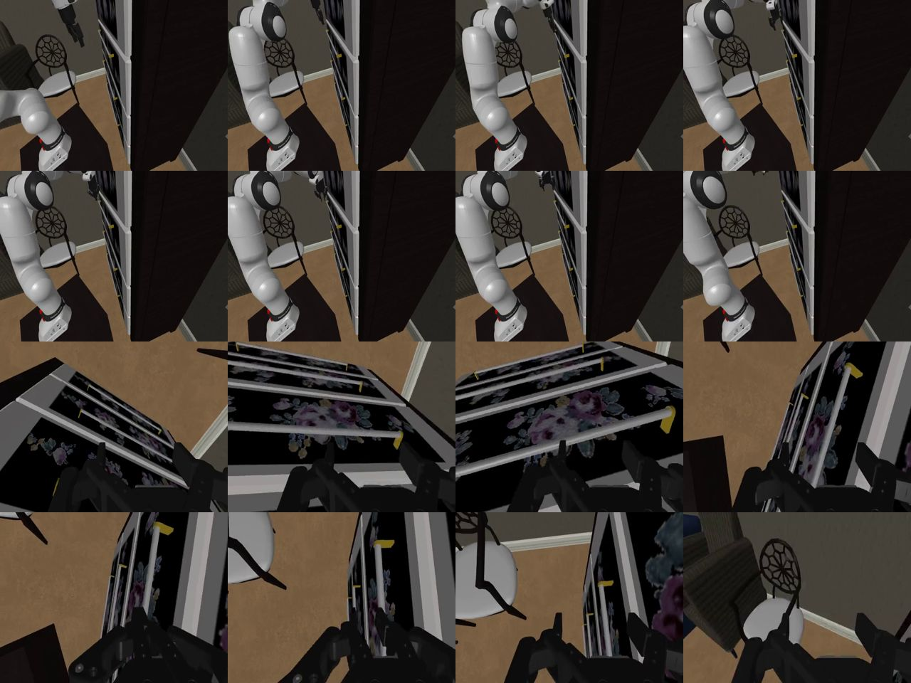

### The rules of 14 November

We added four rules to the MolmoBot server, each with its own server flag (all off by default; code in
`positronic_changes/molmobot_v3_jpeg_rl2/`):

| Flag | Rule |
|---|---|
| `--model.reword_tasks=True` | A task in another wording gets the wording of MolmoBot's training data: "Stack the yellow block on the red block" → "Pick up the yellow block and place it in or on the red block", "Grab a bagel" → "pick up the bagel." The 320 board tasks keep their text (checked: 0 of 320 change); 64 of the 120 RoboLab tasks change (`steps.py`) |
| `--model.split_tasks=True` | A task of several objects is given one step at a time, in the order of the task: "Put the cube and the banana in the bowl" → first the cube, then the banana. The next step starts when the gripper lets go of an object that it held for 2 calls |
| `--model.miss_deeper_m=0.02` | After a close on nothing (the gripper reads ≥ 0.95), a close within 6 cm of that place first moves the open gripper 2 cm lower (at most 3 times per episode, not in open and close tasks; `arm.py` gives the straight move) |
| `--model.close_votes=3` | A chunk that closes an open gripper is made 2 more times from the same observation; the gripper closes only when 2 of the 3 chunks close it |

Before the cloud tests, each rule was checked inside the image with a stand-in model that returns scripted chunks.

**Cloud test, board tasks** (40 episodes, 2 servers on one L40S, 4 episodes at a time each):

| Task group | Control (no new rule) | All rules | Deeper grasp | Vote | v3 (10–11 Nov) |
|---|---|---|---|---|---|
| Pick, hard (14) | 8 | 10 | **12** | 11 | 10 |
| Pick and place (6) | 5 | 5 | 5 | 5 | 5 |
| Open (10) | 1 | 2 | 2 | 2 | 3–4 |
| Close (10) | 8 | 8 | 9 | 9 | 8 |
| **All (40)** | **22** | **25** | **28** | **27** | **26–27** |

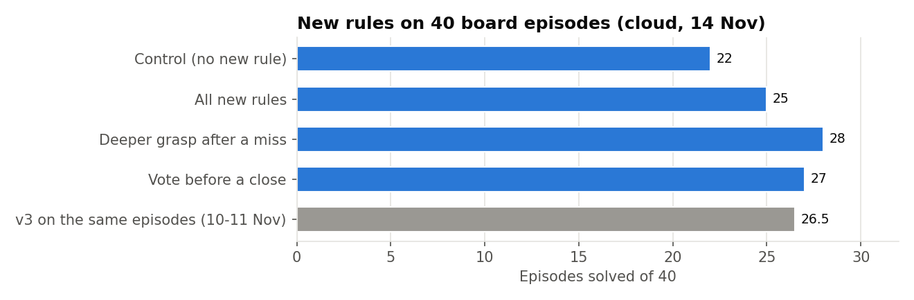

The deeper grasp acted in 12 episodes: the white stopwatch and the egg, which failed in all three runs without it,
succeeded; one task that usually succeeds failed. The vote changed only 8 of 223 closes.

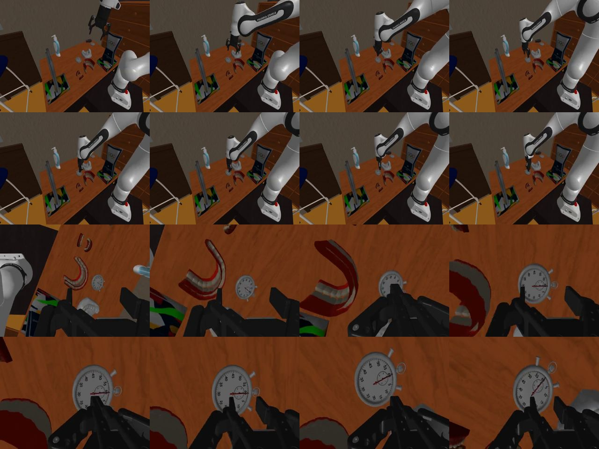

**Cloud test, RoboLab** (the 12 tasks of the platform's `robolab.subset_12`, one episode each, the variants one after
the other on one L40S):

| Category | Tasks | Control (v3-jpeg-rl) | Training wording + steps | All rules | Platform run of v3 (10 Nov) |
|---|---|---|---|---|---|
| Visual | 4 | 2 / 0.88 | 3 / 0.88 | 3 / 0.88 | 3 / 0.88 |
| Relational | 4 | 0 / 0.12 | 0 / 0.12 | 1 / 0.38 | 1 / 0.25 |
| Procedural | 4 | 0 / 0.08 | 0 / 0.08 | 0 / 0.13 | 0 / 0.08 |
| **All (successes / mean score)** | 12 | 2 / 0.36 | 3 / 0.36 | **4 / 0.46** | 4 / 0.40 |

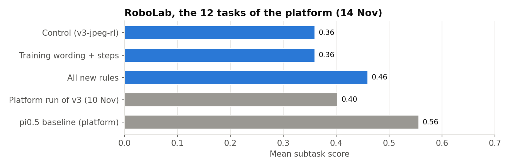

- The training wording changed 8 tasks; no failed task became a success (the stacking tasks stayed at 0). The steps
  rule went to the second step of "Put the cube and the banana in the bowl" once; the second object was not placed.
- The gain of "all rules" is mostly one task, "Put 2 bananas in the crate", whose wording the rules do not change.

**Decision:** image **v3-jpeg-rl2** = v3-jpeg-rl + training wording + steps + deeper grasp (no vote).

| | v3-jpeg-rl2 (14 Nov) | v3-jpeg-rl (13 Nov) | v3 (7 Nov) |
|---|---|---|---|
| Board total | 214 | 212 | 219 |
| Pick, hard | 34 | 33 | 39 |
| Pick and place, all four sets | 106 | 102 | 105 |
| Deeper grasps in the board run | 260 | – | – |

On the full board the deeper grasp gives no gain beyond the noise (it acted 260 times; pick hard 34 against 33). It did
not harm, and the image is the best of ours in the RoboLab cloud test, so it is our planned stage-2 image.

---

## 13 November: why v3 fails, the late-close rule, the first RoboLab test and image v3-jpeg-rl (66.3%)

### Late-close rule (no gain)

An offline replay of 6 recorded episodes through the model said that 21% of the chunks for an open gripper close it
only in their last 4 actions, and that most of these closes are chance (1 or 2 of 6 chunks of the same observation).
The rule kept the gripper open in such a chunk (`--model.close_before=12`).

| Run (40 episodes, cloud) | All | Pick (20) | Open (10) | Close (10) | Closes on nothing per pick episode |
|---|---|---|---|---|---|
| Late-close rule, 1 deferral | 24 | 14 | 3 | 7 | 3.5 |
| Late-close rule, each time | 24 | 14 | 2 | 8 | 3.0 |
| v3 (10–11 Nov) | 26–27 | 15 | 3–4 | 8 | 3.5–3.6 |

The rule acted on only 2% of the live calls: the replay did not predict the live server. On the 25–27 episodes that ran
with normal call times, the score equalled v3 (17 = 17, 15 = 15); the other episodes ran while 3 servers shared the GPU
(calls of 1.7–2 s), which we do not do again.

### First RoboLab test (12 tasks, 4 per category)

RoboLab needs an RTX GPU (Isaac Sim with Vulkan), so it ran on a cloud L40S. v3-jpeg runs in RoboLab with no change and
no error (model call 0.16 s).

| Category | Tasks | Successes | Mean score |
|---|---|---|---|
| Visual | 4 | 3 | 0.88 |
| Relational | 4 | 1 | 0.33 |
| Procedural | 4 | 1 | 0.25 |
| **All** | 12 | 5 | 0.49 |

In 3 of the 7 failed tasks the arm froze with an open gripper from about 4 s to the end; no success froze. The still-arm
rule of v3 (7 November) is for this case, but its wording ("pick up the X and place it on the Y") matched none of the
120 RoboLab tasks ("Put the X in the Y").

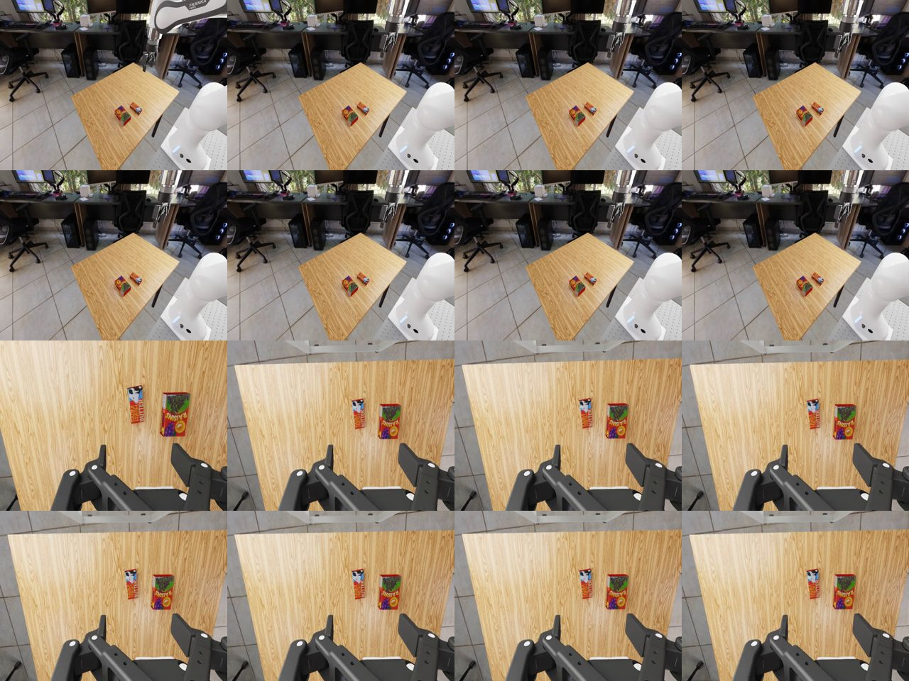

### Image v3-jpeg-rl

The still-arm rule now also reads "put / place / move / stack the X …" and "pick up the X and place / put it …" (54 of
the 120 RoboLab tasks; the 320 board tasks get the same pick part as before).

| RoboLab, same 12 tasks | v3-jpeg | v3-jpeg-rl |
|---|---|---|
| Successes | 5 | 5 |
| Mean score | 0.49 | **0.51** |
| "Put the rubiks cube to the left of the bowl" | 0.33 | **0.67** |

The rule acted in 5 of 12 tasks; no task got worse. Board run: 212/320 (the rule does not act on board tasks).

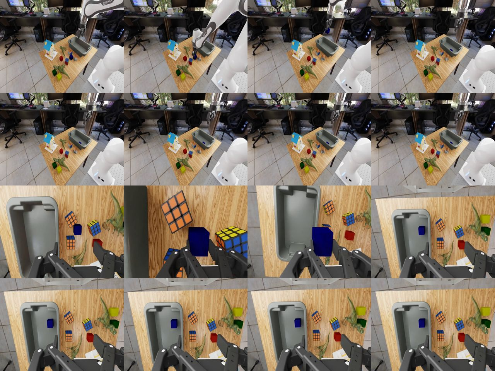

---

## 12–13 November: FLUX 3 Action (a new public model) in the 24 GB of a board run (no gain)

FLUX 3 Action DROID (Black Forest Labs, public image `positro/flux3-action`) is one of the public models of the real
robot board. Published, it needs about 33 GB of GPU memory; a board run gives 24 GB. We made it fit: text encoder
on the CPU, the DiT packed in place, memory capped at 24192 MiB (peak of the process 19,084 MiB, no out-of-memory error).
Then five cloud tests on the 40 episodes of our board-load test:

| Run (40 episodes) | All | Pick + pick-and-place (20) | Open (10) | Close (10) |
|---|---|---|---|---|
| FLUX as published (24 GB) | 15 | 3 | 3 | 9 |
| FLUX + v3 rules (left camera, still-arm rule, v3 timing) | 13 | 4 | 0 | 9 |
| Try 3: request the next plan 0.9 s earlier (no waiting) | 14 | 0 | 5 | 9 |
| Try 4: both shoulder cameras, whole plan | 18 | 7 | 2 | 9 |
| Try 4: both shoulder cameras, 1.03 s of each plan | 19 | 8 | 1 | 10 |
| Try 5: firm gripper (closed from 0.35 until 0.1) | 14 | 4 | 0 | 10 |
| Try 5: firm gripper + hybrid timing | **20** | 6 | 4 | 10 |
| **v3 (MolmoBot), same episodes** | **26–27** | **15** | 3–4 | 8 |

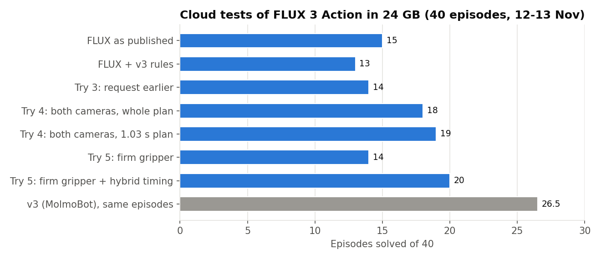

- A FLUX call takes about 0.85 s (MolmoBot: 0.23 s). With the v3 timing the robot stood still 9.9 s per episode.
- Requesting earlier removed the waiting, but the plans were older: command jumps 3 times bigger, and pick fell to 0.
- FLUX learned from both shoulder cameras: giving it both (as published, one view twice) helped pick most (+4 to +5).
- A firm gripper made it close too early ("closed on nothing" 1 → 7 of 20 pick episodes).
- Continuous motion helped open tasks (5/10 and 4/10 against 0–2/10 with stop-and-think).
- Decision: FLUX stays below v3 by 6 or more episodes; we stopped the FLUX work. (FLUX also has a non-commercial
  licence.)

---

## 11 November: JPEG camera frames, image v3-jpeg (65.6%)

The model server can ask the client for JPEG frames (quality 90) in place of raw frames
(`positronic_changes/patches_v3_line/0007-Ask-for-JPEG-camera-frames-in-the-MolmoBot-server.patch`). A raw frame makes
each call slow on a network, and the real robot and RoboLab send three cameras.

| Cloud board-load test (H100, 40 episodes) | v3 + JPEG | v3, raw frames | v3 (10 Nov, L40S) |
|---|---|---|---|
| Solved | 26/40 | (stopped after 6) | 27/40 |
| Model call, median (charged to the robot) | 322 ms | 820 ms | 232 ms |

Board: 210/320 against 219 for v3 (pick hard 31 against 39; the other sets within ±3): in the noise. We kept JPEG for
stage 2.

---

## 10 November: image v6, both action experts on the GPU (65.0%)

v5-touch swapped two action experts on the GPU at each task change (about 290 ms of robot time each). v6 keeps both on
the GPU (1.07 GB more memory). Board-load test in the cloud (2 servers, 4 episodes at a time each, as the board runs):

| 40 episodes | v6 | v5-touch | v3 | v4 |
|---|---|---|---|---|
| Solved | 27 | 25 | 27 | 29 |
| Model call, median | 245 ms | 485 ms | 232 ms | 231 ms |

Board: 208/320 (v5-touch 197): the fix works, but pick and pick-and-place stay below v3 (186 against 199). From here on we
built on v3.

---

## 9 November (evening): top-5 study, cloud test and image v5-touch (61.6%)

### Study of the top 5 teams

The board shows a public replay (videos) of the best run of each team. The rules say: "Do not train on data from our
evaluation runs, other than the results of your own team". We used the replays only to compare and to choose test
episodes. We did not train on them.

`risers/competition_runs/board_videos/download_board.py` reads the board without a key and downloads the replays of
the top 5 and our own. `compare_top.py` compares the successes per set:

| Set | Episodes | #1 | #2 | #3 | #4 | #5 | Our v3 | Top-5 mean − v3 |
|---|---|---|---|---|---|---|---|---|
| Pick, normal | 59 | 56 | 57 | 55 | 56 | 55 | 55 | +0.8 |
| Pick and place, hard | 58 | 41 | 42 | 35 | 40 | 39 | 39 | +0.4 |
| Pick, hard | 57 | 44 | 39 | 37 | 33 | 41 | 39 | −0.2 |
| Pick and place, normal | 54 | 49 | 45 | 44 | 47 | 43 | 48 | −2.4 |
| Pick and place, color | 16 | 15 | 15 | 15 | 11 | 13 | 12 | +1.8 |
| Place next to | 16 | 8 | 4 | 0 | 5 | 4 | 6 | −1.8 |
| Close, normal | 15 | 13 | 13 | 15 | 14 | 11 | 13 | +0.2 |
| Open, normal | 15 | 4 | 6 | 6 | 5 | 5 | 2 | +3.2 |
| Open, hard | 15 | 4 | 5 | 6 | 4 | 4 | 1 | +3.6 |
| Close, hard | 15 | 4 | 12 | 12 | 9 | 7 | 4 | +4.8 |
| **All** | 320 | 238 | 238 | 225 | 224 | 222 | 219 | **+10.4** |

The gap to the top 5 is in the open tasks (+6.8 episodes) and the hard close tasks (+4.8). On pick tasks we are
level with them. 8 of the 30 open episodes are solved by no top-5 team.

**How their arms move.** The replays have only videos, no gripper data. `grip_from_video.py` reads the gripper
closure from the wrist video. It is a linear model of the finger area of the image, trained on our own local runs,
where the true gripper signal is known. On local runs it did not see, it finds the first close within 1 s in 74% of
the episodes. On the hard pick sets the wrist camera sits differently in each episode, and the reading is wrong in 29%
to 50% of them. So we use only the 6 sets where it is right.

| Set | Top-5 successes: first close, closes | Our v3 successes: first close, closes | Our v3 failures: first close, closes |
|---|---|---|---|
| Pick, normal | 2.9 s, 1 | 3.4 s, 1 | 3.4 s, 10 |
| Pick and place, normal | 3.7 s, 1 | 3.8 s, 1 | 3.6 s, 11 |
| Open, normal | 8.8 s, 1 | 11.7 s, 1 | 4.9 s, 9 |
| Close, normal | 3.0 s, 0 (push) | 2.8 s, 0 | 5.3 s, 10 |

- When we succeed, we move like the top teams: one grasp at about the same time.
- When we fail, the gripper closes 9 to 11 times: the first grasp misses and every retry misses too.
- In open tasks the top teams close the gripper at about 8.8 s, after they reach the handle. Our failures close at
  about 4.9 s, before the handle. This supports the touch grasp (below).
- In close tasks the top teams push the door shut and do not close the gripper. v3 grasps again and again. The close
  push rule of v4 does the same as the top teams.

### Test set of 34 "reliable" episodes, run in the cloud

`tests_1108/reliable34.json` holds the 34 board episodes that 3 or more of the top 5 solve and that 2 or more of our 3
board runs (v3, v4, v5) failed. We ran v3 and v5-touch on them on a Nebius cloud VM (L40S GPU, 32 CPUs). Three test
streams ran side by side, each with its own policy server (a fourth server did not fit in the 48 GB GPU). Time 1.1 h,
cost $2.53 (plus $0.28 for a first start that stopped at the setup).

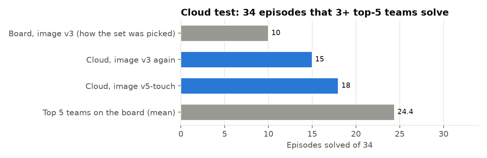

| Group | Episodes | Board v3 | Cloud v3 | Cloud v5-touch | Top-5 mean |
|---|---|---|---|---|---|
| Open and close | 11 | 4 | 3 | 5 | 7.8 |
| Pick and pick and place | 23 | 6 | 12 | 13 | 16.6 |
| **All** | 34 | 10 | 15 | **18** | 24.4 |

v3 gets 15 in the second run because the set holds episodes that we failed before; the second v3 run agrees with the
board run on only 21 of the 34 episodes. So the fair comparison is v5-touch against v3 in the same cloud run: 18
against 15. In open and close tasks v5-touch gains: hard close 0 → 2, normal open 2 → 3. It lost one normal close
episode (#86), where v5 is slow.

### Board result of v5-touch: 61.6%

We submitted v5-touch (v5 + touch grasp) on 9 November, while 5 submissions per day were still allowed.

| | v3 | v4 | v5 | v5-touch |
|---|---|---|---|---|
| Open (30) | 3 | 1 | 1 | **4** |
| Close (30) | 17 | 19 | **20** | 18 |
| Pick and pick and place (260) | **199** | 195 | 194 | 175 |
| **Total** | **219** | 215 | 215 | 197 |

Open tasks gave our best board result (4/30). But pick tasks fell by about 20 episodes. In the 4 earlier runs with
per-set data the pick tasks were always 194 to 199, so this is not noise. The pick code is the same in v5 and v5-touch (we compared the code
inside the two images).

**Cause (most likely): the action expert swap.** Images v5 and v5-touch hold two action experts. Only the one in use
stays on the GPU; the other waits on the CPU. The board runs about 4 episodes at a time on one policy server, so pick
and open/close calls alternate. v5 changed the expert 1,814 times and v5-touch 1,509 times. A change moves 2 × 1.07 GB
between the CPU and the GPU: **290 ms** on our PC (measured in the image), more than a model call (180 ms). The
platform charges the robot the wall time of each model call (`eval.charge_inference_time = True`, also in the
simulator), and the server does one call at a time. So each change also stops the other episodes. The hard pick set
has the shortest time limit (21 s), and it lost the most: v3 39, v4 40, v5 36, v5-touch 29. Our local and cloud tests
run one episode per server, so they did not show this.

**Fix:** keep both action experts on the GPU (1.07 GB more GPU memory). The next image will have this fix.

---

## 9 November: grasp rules for open tasks (local tests)

All tests on the 30 open episodes of the board (`tests_1108/open30.json`), on the local PC, one episode at a time.

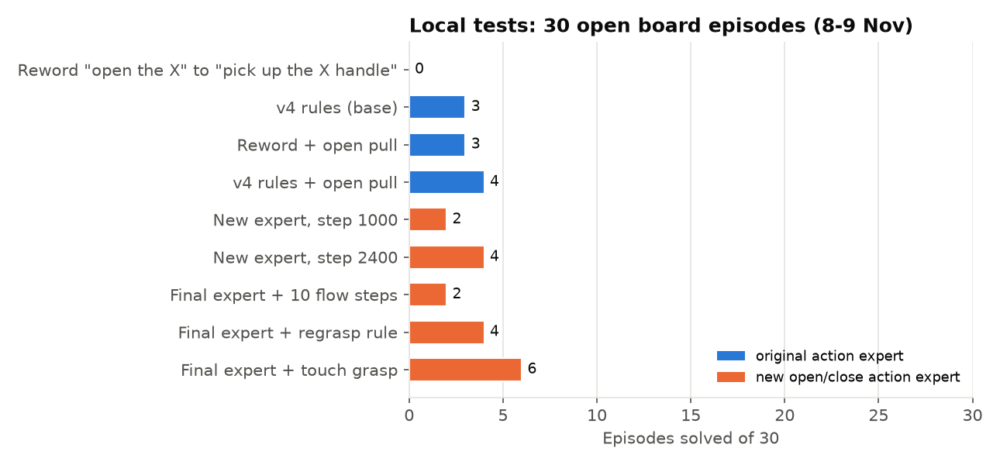

| Run | Action expert | Rules | Open, normal | Open, hard | Solved |
|---|---|---|---|---|---|
| op_base | original | v4 rules | 2/15 | 1/15 | 3 |
| op_word | original | v4 + reword to "pick up the X handle" | 0/15 | 0/15 | 0 |
| op_both2 | original | v4 + reword + open pull | 3/15 | 0/15 | 3 |
| op_pull | original | v4 + open pull | 3/15 | 1/15 | 4 |
| op_step1000 | ours, step 1000 | v4 + open pull | 1/15 | 1/15 | 2 |
| op_step2400 | ours, step 2400 | v4 + open pull | 3/15 | 1/15 | 4 |
| op_regrasp | ours, final | v4 + open pull + regrasp | 3/15 | 1/15 | 4 |
| op_flow10 | ours, final | v4 + open pull + 10 flow steps | 1/15 | 1/15 | 2 |
| **op_touch** | ours, final | v4 + open pull + touch grasp | **5/15** | 1/15 | **6** |

### Why the model does not open: it does not hold the handle

The gripper data of the local runs shows that neither expert holds a handle. The longest hold in an episode is 0.5 to
0.7 s (median), and the hand moves about 1 cm while closed. Our demos close once at about 5 s, hold about 5 s and pull
16 to 21 cm. Most open wins of both experts came from a bump of the arm, not from a grasp and a pull.

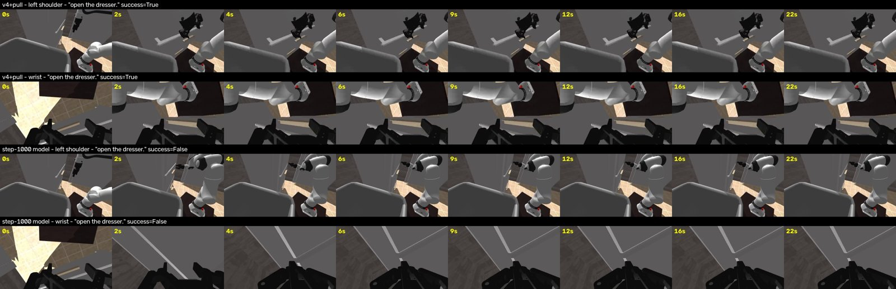

*Episode #107 "open the dresser.": the original expert with the open pull (top two rows) opens the drawer. The step-1000
expert (bottom two rows) moves to the side of the drawer and stays there.*

### Regrasp rule: no gain

Option `--model.open_regrasp`: when a level gripper closes on nothing, it backs off 3 cm, moves 6 cm in with an offset
of 0, +3 or −3 cm along the finger axis, and closes again. Result 4/30, the same as without it. The rule fired 72
times in 20 episodes, and only 1 try closed on something. Each try costs about 2.3 s of the 31 s. The wrist pictures
show why: the handle is 5 to 15 cm away or not in view. The misses are aim errors, not small offsets.

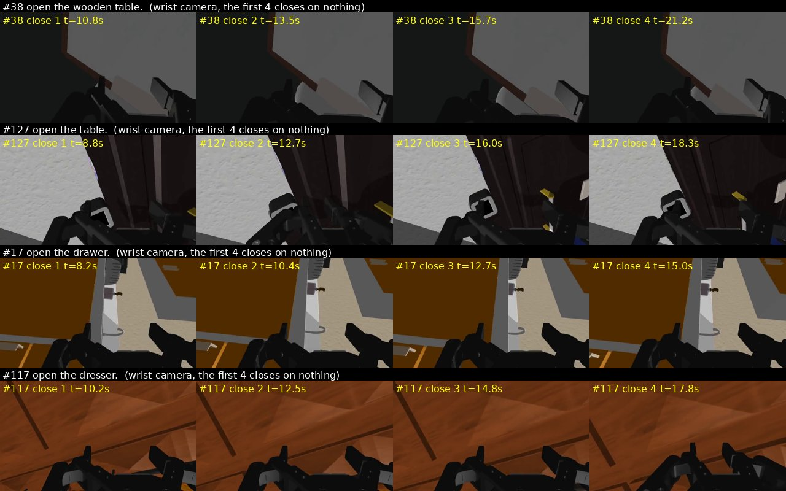

*Wrist camera at the first 4 closes of 4 failed open episodes: each close is on nothing.*

### 10 flow steps for open and close tasks: worse

Option `--model.open_close_flow_steps=10` (the model default; we use 3). Result 2/30.

### Touch grasp: the best open result (6/30)

Option `--model.open_touch`. When the model closes a level, open gripper in an open task, a script takes over:

1. On a drawer-like task (drawer, dresser, desk, table, nightstand, chest), turn the fingers so they close vertically
   (a drawer handle is mostly a horizontal bar).
2. Move the open gripper in along its axis, 3 cm per call, until a call moves it less than 1 cm (it touches
   something) or after 3 calls.
3. Close. When two readings in a row show the fingers stopped on something, pull (the open pull, chained).

At most 2 touch grasps per episode. Result: 6/30 (normal 5/15, hard 1/15). 56 touch grasps, and 13 pulls in 12
episodes; the earlier runs had 0 to 8 pulls.

---

## 9 November: open/close data, cloud training and image v5 (67.2%)

### Why train: the model never saw open or close tasks

The MolmoBot training data has 8 task kinds on 2 robots. For the Franka arm there are only pick, pick and place, color
and next-to tasks. Open and door data exists only for the RB-Y1 robot. So the DROID model never saw open or close
tasks.

### Data generation

`risers/datagen/risers_datagen.py` adds MolmoSpaces data configs that make open and close demos with the scripted
planner of MolmoSpaces:

- `RisersOpenMore`, `RisersCloseMore`: normal rooms (iTHOR train rooms; the board uses the validation rooms).
- `RisersOpenHard*`, `RisersCloseHard*` (iTHOR, ProcTHOR, Holodeck): copies of the board's hard benchmark settings
  (start pose noise 0.26 rad, height ±0.25 m, base turn ±0.52 rad) with the board's hard cameras.

The local PC made the normal demos (3 workers). A Nebius cloud VM (L40S, 16 workers) made the hard demos in 2.7 hours
($6.07).

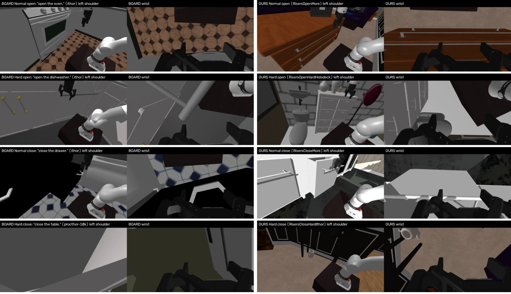

*Left: board episodes. Right: our generated demos of the same task kinds.*

| Demos | Normal rooms | Hard settings | All |
|---|---|---|---|
| Open | 668 | 574 | 1,242 |
| Close | 229 | 484 | 713 |
| **All** | 897 | 1,058 | **1,955** |

Each demo is used twice in training, once with the left and once with the right shoulder camera (3,910 trajectories).

### Training on the H100

| | |
|---|---|
| Model | MolmoBot-Img-DROID. Only the action expert trains (536 M parameters); the rest is frozen |
| Steps | 2,500 steps × 128 trajectories, about 3.5 s per step (2 h 25 min) |
| Machine | Nebius H100 80 GB VM, 4.1 h with setup, $18.62 |
| Saves | Every 200 steps, copied to the local disk (the first run stopped at step 1,160 to add the saves; the restart gave the same loss at every step) |
| Loss | Action flow loss 0.067 (step 20) → 0.022 (step 2,500) |

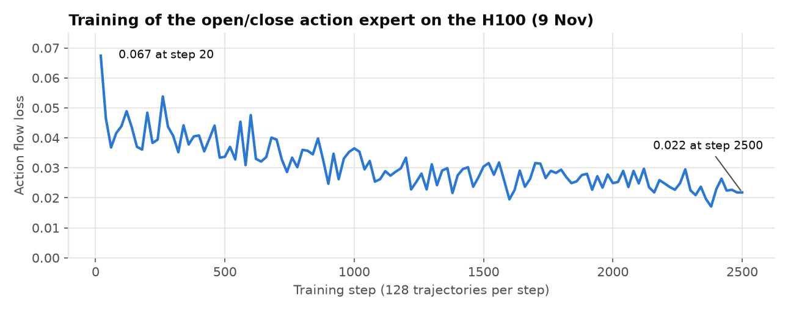

### Image v5: two action experts

New server options `--model.open_close_expert=<file>` and `--model.open_close_expert_tasks=both|open|close`. Tasks
that start with "open the" or "close the" use our action expert; all other tasks use the original one. Image v5 = v4
flags + `--model.open_pull=True` + our expert (patch `0010`).

Board result (submission `3f52961f7f2dcab4`): **215/320 = 67.2%**. Open 1/30, hard close 8/15 (v3: 4), normal close
12/15 with a median time of 7.8 s (v3: 1.9 s). Our expert levels the gripper only after a median of 6.4 to 7.0 s; the
demos do it in 2.8 s.

### Local tests of the saved experts

Step 1,000: 2/30 open. Step 2,400: 4/30, the same as the original expert with the open pull. We stopped the tests of
steps 2,000, 1,400 and 800 because the later steps gave no gain.

---

## 8 November: open tasks, the open pull and v3 again (68.1%)

### v3 again: 218

The same v3 image gave 218 (first run 219). This measures the noise (see "Run-to-run noise" above).

### Why open tasks fail

- All 30 open episodes start closed. Success: the joint opens to 15% of its range or more. 47 of the 60 open and
  close objects slide (drawers), 13 turn on a hinge (doors).
- In failed open episodes of v4 the gripper travels a median of 2.0 m in 30 s, but never more than 39 cm from its
  start. It wanders back and forth. The fingers are closed 35% to 40% of the time, and 90% of those closed readings are
  fully shut: the gripper grasps air.
- Gap to the 1st team: all in the normal sets (open normal 1.3 against 5, close normal 12 against 15). On the hard sets
  our mean is equal to theirs.

### Open matrix

Two new options (patch `0010`): `--model.open_as_pick` (the open task becomes "pick up the X handle.") and
`--model.open_pull` (when the gripper holds something, pull it straight out 6 mm per action for 2 calls, at most 3
times). Results: see the open test table above (op_base 3, op_word 0, op_both2 3, op_pull 4). Reword hurts; the pull
gives +1.

### Hard pick failures (v4 board, 37 failures)

| Cause | Episodes |
|---|---|
| The object slipped after the grasp | 12 |
| Never near the target object | 7 |
| Held another object | 7 |
| Closed at the target, but every try missed | 8 |
| Object too large (toilet, pan, pot) | 3 |

Of the 115 hard pick episodes, 59 were solved in all 3 runs (v3, v4-push, v4), 37 in some and 19 in none.

---

## 7 November (evening): close push and camera switch, images v4-push and v4 (67.8%, 67.2%)

### Blocked left camera

`competition_runs/video_tools/camera_check.py` measures the detail (mean grey gradient) of each shoulder camera. In
about 7 board episodes of v3 the left camera sees only furniture or a wall. Almost all are open or close tasks.

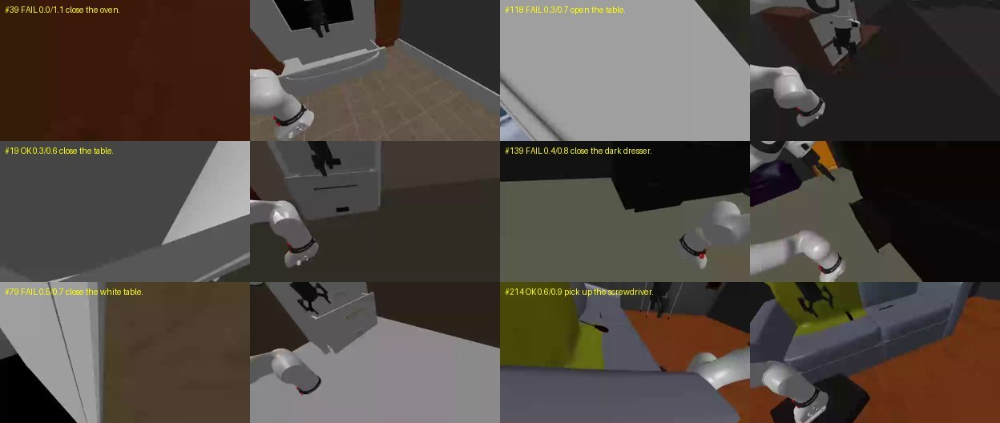

*Left image of each pair: the left shoulder camera (blocked). Right image: the other shoulder camera.*

Option `--model.camera_fallback=True`: when the detail of the left camera is below 0.6 and the other camera has 1.5
times more, the model uses the other camera.

### Close push

The v3 videos show that in close tasks the robot reaches the door and then waits near it, or grasps it again and
again. Option `--model.close_push_after=6` (patches `0007`, `0008`, with a numpy forward kinematics of the FR3 in
`arm.py`): after 6 model calls, when the gripper stays within 8 cm for 4 readings, a script pushes. A gripper that
points down drops 6 or 10 cm and then pushes 3 × 12.8 cm away from the robot base. A level gripper pushes along its
axis. At most 3 pushes, with 4 model calls between them.

### Local tests: 15 hard close episodes

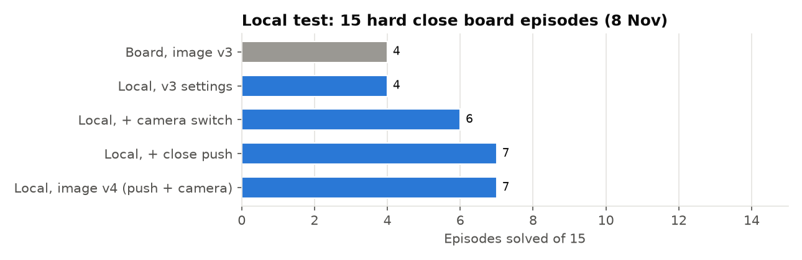

| Run | Hard close | Notes |
|---|---|---|
| v3 settings | 4/15 | The same 4 as the board |
| + close push | 7/15 | Push solved #109 and #129 (and #149); faster #19 (27 → 11 s) and #49 (14.5 → 8.4 s). No losses |
| + camera switch | 6/15 | Switch solved #79 |
| image v4 (both) | 7/15 | The wins of both, no losses |

### Board results

| Submission | Close, hard | Total |
|---|---|---|
| v3 | 4 | 219 |
| v4-push (`2518efd8af2927f6`) | 6 | 217 (67.8%) |
| v4: push + camera (`2e63188780383ff`) | 9 | 215 (67.2%) |

The fix works on the board: hard close went from 4 to 9. But the other 290 episodes vary by about ±6 per run, so the
total did not go up.

We also checked MolmoAct2 for close tasks (it solved 8 or 9 hard close episodes on the board). MolmoAct2 (15 GB) and
MolmoBot (10.5 GB) do not fit the 24 GB board GPU together, so we dropped it.

---

## 7 November: the frozen arm, still-arm rule and image v3 (60.0% → 68.4%)

### The problem

The replay videos of image v2 show 26 failures where the arm makes a small move in the first 1 to 3 s and then
stays still until the time limit. We call these episodes "frozen". The object is often right below the gripper.

| Set | Frozen failures | All failures |
|---|---|---|
| Pick and place, normal rooms | 11 | 15 |
| Pick and place, hard | 8 | 24 |
| Place next to | 5 | 12 |
| Open, hard | 2 | 14 |
| Pick, both sets | 0 | 31 |

On the local PC, a frozen arm moves about 0.004 rad in 3 s (median of the largest joint change). Other failed
episodes move 0.17 to 0.47 rad in 3 s.

Test set: `risers/tests_1107/frozen19.json` holds 19 board episodes that froze with image v2 (11 pick and place in
normal rooms, 8 hard pick and place).

### Test 1: task wording and 3 flow steps — did not stop the freeze

The board pick-and-place tasks say "pick up the X and place it on the Y.". The MolmoBot training data says "Pick up
the X and place it in or on the Y". The new server option `--model.training_wording=True` (patch `0005`) gives the
model the training wording.

| Setting | 19 frozen episodes: solved | Frozen | 28 hard episodes: solved |
|---|---|---|---|
| 5 flow steps, board wording (image v2) | 2 | 14 | 16 |
| 5 flow steps, training wording | 3 | 15 | – |
| 3 flow steps, board wording | 4 | 14 | 17 |
| 3 flow steps, training wording | 2 | 13 | 18 |

- The arm also freezes on the local PC. The wording and the flow steps do not stop it. 10 of the 19 episodes froze
  in all 4 runs.
- With 3 flow steps the robot waits 42% of the time, against 47% with 5. A gain of 1 or 2 episodes of 28 is inside
  the run-to-run noise (about 4 episodes).

### Test 2: what makes a frozen arm move

The model starts each call from new random noise. So a second call with the same input does not help. In a frozen
episode, the commands of the model are small too: the arm is not blocked.

`risers/tests_1107/probe_freeze.py` loads the model and takes the recorded camera frames and joints at 8 s and 20 s
of the frozen local episodes. It asks the model 3 times for each changed input, and measures the largest joint
change of the 12 actions that the robot plays. At 16 of the 28 moments the probe gives the frozen answer again. At
the other 12 moments the arm moves with no change, probably because the recorded video is compressed.

| Change of the input | Moments where the arm moves (of 16) | Answers that move (of 48) |
|---|---|---|
| No change | 0 | 1 |
| The other shoulder camera | 4 | 12 |
| The training wording | 1 | 3 |
| 10 flow steps | 0 | 1 |
| **Only the pick part of the task: "pick up the X."** | **16** | **48** |

The pick sets never froze on the board, and the pick part of the task moves the frozen arm every time.

### The still-arm rule

New server option `--model.still_calls=N` (patch `0006`):

- The server keeps the arm joints of the last N + 1 calls of each episode.
- When the joints stay within 0.02 rad and the gripper is open, the model gets only the pick part of a
  pick-and-place task: "pick up the X.".
- When the gripper closes, the model gets the full task again.
- The rule reads the 3 board wordings: "place it on", "place it in or on" and "place it next to". That is 144 of the
  320 board tasks. Pick, open and close tasks do not change.
- The server logs each switch: "the arm is still and the gripper is open".

With N = 3, the switch comes after about 2.5 s of a still arm on the competition machine.

### Test 3: the rule on the local PC — helped

| Run (3 flow steps) | 19 frozen episodes: solved | Frozen | Rule switches |
|---|---|---|---|
| Without the rule | 4 | 14 | – |
| **With the rule** | **10** | **0** | 15 |

- Pick and place in normal rooms: 8 of 11, against 2 of 11 without the rule.
- Hard pick and place: 2 of 8. The arm moves, but the grasp fails.
- 8 of the 10 episodes that froze in all 4 runs of test 1 were solved.

Check on the 28 hard episodes (`hard28.json`), 3 flow steps:

| Run | Solved | Hard pick | Hard pick and place | Frozen | Rule switches |
|---|---|---|---|---|---|
| Without the rule | 17/28 | 10/16 | 7/12 | 1 | – |
| With the rule | 17/28 | 9/16 | 8/12 | 0 | 0 |

The arm did not freeze in these 28 episodes, so the rule did not switch. The result is the same as without the rule,
inside the noise. So the rule does not harm episodes where the arm moves.

The full tables: [risers/tests_1107/results.md](risers/tests_1107/results.md) and
[risers/tests_1107/probe_freeze.md](risers/tests_1107/probe_freeze.md).

### Image v3

Image `docker.io/denistonantony/molmobot-img-droid@sha256:0a62b44de814b613a048914e8b4b892ba8973dede2a3e9c9db007477f49185fa`
(tag `v3`, public). It is image v1 with one more layer (`risers/molmobot_image/Dockerfile.settings`). The layer holds
the current MolmoBot server code and these server flags:

```
--model.camera=left --pipeline.horizon_sec=0.7667 --model.num_flow_steps=3 --model.still_calls=3
```

Platform start test (`docker/test_policy_image.sh --gpu`, no network): pass, the server answered after 65 s.

### Board result of image v3: 68.4%, rank 2

Submission `2a74d6b52a67c4be`: **219/320 = 68.4%**, rank 2 of 33. Image v2: 192/320 = 60.0%.

| Set | Episodes | v3 | v2 | Change | v3 median s | v2 median s |
|---|---|---|---|---|---|---|
| Pick, normal rooms | 59 | 55 | 56 | −1 | 4.8 | 5.1 |
| **Pick, hard** | 57 | **39** | 29 | **+10** | 10.5 | 13.1 |
| **Pick and place, normal rooms** | 54 | **48** | 39 | **+9** | 11.2 | 13.1 |
| **Pick and place, hard** | 58 | **39** | 34 | **+5** | 19.6 | 20.7 |
| Pick and place, color | 16 | 12 | 11 | +1 | 18.3 | 22.6 |
| Place next to | 16 | 6 | 4 | +2 | 24.5 | 20.7 |
| Open, data generation | 15 | 2 | 1 | +1 | 19.2 | 19.5 |
| Open, hard | 15 | 1 | 1 | 0 | 5.6 | 7.6 |
| Close, data generation | 15 | 13 | 11 | +2 | 1.9 | 2.3 |
| Close, hard | 15 | 4 | 6 | −2 | 5.0 | 5.0 |

The median columns use the episodes that both images solved in that set.

- Pick and place in normal rooms gained 9. This set had the most frozen failures (11 of 15). The rule switched the
  task 42 times in the 320 episodes (board log `risers/competition_runs/molmobot_img_v3/policy_log.txt`).
- Frozen failures on the board fell from 26 (v2) to 2 (v3; we checked 97 of the 101 failures).
- Hard pick gained 10. The rule does not act on pick tasks, so this gain comes from 3 flow steps and from chance.
  The model time on the competition machine fell to p50 190 ms per call (v2: 245 ms).
- v3 solved 45 episodes that v2 did not solve. v2 solved 18 episodes that v3 did not solve.
- On the 174 episodes that both images solved, the median time fell from 11.4 s to 10.5 s.
- The two changes are in one image, so the board does not separate their gains exactly.
- Our test sets are board episodes. We tuned settings by running them again on the local PC. We did not train
  on them.

### Where the points are now (analysis after v3)

Comparison with the 7 best teams, from their public board replays:

| Set | Episodes | v3 | Best of the top 8 | Gap |
|---|---|---|---|---|
| Pick, normal rooms | 59 | 55 | 57 | 2 |
| Pick, hard | 57 | 39 | 45 | 6 |
| Pick and place, normal rooms | 54 | 48 | 49 | 1 |
| Pick and place, hard | 58 | **39** | 39 | 0 (best) |
| Pick and place, color | 16 | 12 | 14 | 2 |
| Place next to | 16 | **6** | 6 | 0 (best) |
| Open, data generation | 15 | 2 | 8 | 6 |
| Open, hard | 15 | 1 | 5 | 4 |
| Close, data generation | 15 | 13 | 15 | 2 |
| Close, hard | 15 | 4 | 10 | 6 |

- Speed is no longer the main problem: on the episodes that both solved, our robot takes 1.1 times as long as the
  top teams (it was 1.6 to 1.9 times with the 47.2% image).
- Open and close: in the replay videos, the robot goes to the handle and stays there. It does not pull (open) or
  push (close). MolmoBot has no open or close training data. Open is hard for all teams: 14 of our 27 open
  failures are solved by none of the top 7 teams.
- Our MolmoAct2 runs solved 8, 8 and 9 hard close episodes (v3: 4). But MolmoAct2 (about 15 GB) and MolmoBot
  (about 10.5 GB) do not fit together on the 24 GB competition GPU. An 8-bit MolmoAct2 (about 6 GB) could fit.
  This is not tested.
- In 7 episodes the left shoulder camera faces a wall or furniture and sees almost nothing. 6 of them are open or
  close tasks. The other camera sees the scene. `risers/competition_runs/video_tools/camera_check.py` finds them.

---

## 6 November: 12 actions per call and 5 flow steps, image v2 (47.2% → 60.0%)

### Image v2

Image `docker.io/denistonantony/molmobot-img-droid@sha256:d0bdd083425e397046c6e4536000b4aa3b10a4445a0faf46ec6c6f85a7fb1e23`
(tag `v2`, public). It is image v1 with one more layer (`risers/molmobot_image/Dockerfile.settings`). The layer holds
the current MolmoBot server code and these server flags:

```
--model.camera=left --pipeline.horizon_sec=0.7667 --model.num_flow_steps=5
```

| Check | Result |
|---|---|
| Platform start test (`docker/test_policy_image.sh --gpu`, no network) | Pass: the server answered after about 95 s |
| 4 hard episodes that `play12_flow5` solved and `base` failed | 3/4 solved. The robot waits 41% (`play12_flow5`: 39%, `base`: 59%) |

The new code logs the model time once per 100 calls: "MolmoBot inference over 100 calls". The board log then
shows the model time on the competition machine.

### Board result of image v2: 60.0%

Submission `58f19b77fa0acea3`: **192/320 = 60.0%**, against 151/320 = 47.2% for image v1 (`30b01a00181a225`).

| Set | Episodes | v2 | v1 | Change | v2 median s | v1 median s |
|---|---|---|---|---|---|---|
| Pick, normal rooms | 59 | 56 | 56 | 0 | 5.0 | 7.5 |
| **Pick, hard** | 57 | **29** | 14 | **+15** | 9.2 | 16.0 |
| Pick and place, normal rooms | 54 | 39 | 37 | +2 | 12.9 | 21.3 |
| **Pick and place, hard** | 58 | **34** | 19 | **+15** | 19.2 | 33.3 |
| Pick and place, color | 16 | 11 | 9 | +2 | 22.6 | 25.5 |
| Place next to | 16 | 4 | 0 | +4 | – | – |
| Open, data generation | 15 | 1 | 3 | −2 | 19.5 | 21.3 |
| Open, hard | 15 | 1 | 1 | 0 | – | – |
| Close, data generation | 15 | 11 | 9 | +2 | 2.3 | 3.8 |
| Close, hard | 15 | 6 | 3 | +3 | 3.7 | 11.6 |

- The two hard sets give 30 of the 41 more successes. The top 6 teams solved 25 to 40 hard pick episodes and 32 to
  39 hard pick and place episodes. Image v2 solved 29 and 34, so it was then in their range.
- On the 130 episodes that both images solved, the median time fell from 16.0 s to 9.9 s.
- v2 solved 62 episodes that v1 did not solve. v1 solved 21 episodes that v2 did not solve.
- The board log (`risers/competition_runs/molmobot_img_v2/policy_log.txt`) gives the model time on the competition
  machine: p50 245 ms per call (67 logs of 100 calls, 242 to 266 ms).
- Open was the weakest task: 2 of 30. Place next to was 4 of 16.

---

## 5–6 November (night): speed tests on 28 hard episodes

### Why speed

The public board replays of the 47.2% image showed that the two hard sets hold the largest gap:

| Set | Episodes | Time limit | The Risers (47.2% image) | Top 6 teams |
|---|---|---|---|---|
| Hard pick | 57 | 21 s | 14 (25%) | 25–40 (44–70%) |
| Hard pick and place | 58 | 41 s | 19 (33%) | 32–39 (55–67%) |
| Pick, normal rooms | 59 | 31 s | 56 (95%) | 51–56 (86–95%) |

On the episodes that both we and a top-6 team solved, our robot took 1.6 to 1.9 times as long, in every set. The
robot waited for the model for about 63% of each episode, and the hard sets have short time limits.

### Test set

`risers/eval_local/hard28.json`: 28 board episodes from the two hard sets.

| Group | Hard pick | Hard pick and place |
|---|---|---|
| Our board run failed, and 6 or more of the 11 best teams solved | 12 | 9 |
| Our board run solved | 4 | 3 |

### Model time per call (model alone on the GPU)

| Flow-matching steps | Time per call |
|---|---|
| 10 (default) | 439 ms |
| 5 | 282 ms |
| 3 | 218 ms |

Each flow-matching step takes about 32 ms. The rest of the call takes about 120 ms.

### Step 1: more actions per call and fewer flow steps — helped a lot

All runs use MolmoBot-Img-DROID, half-overlap timing and the left camera.

| Run | Actions played per call | Flow steps | Solved | Hard pick | Hard pick and place | Robot waits | Time per call (with the simulator) |
|---|---|---|---|---|---|---|---|
| base (the 47.2% image) | 8 | 10 | 3/28 | 1/16 | 2/12 | 65% | 1062 ms |
| play12 | 12 | 10 | 6/28 | 3/16 | 3/12 | 56% | 1165 ms |
| flow5 | 8 | 5 | 7/28 | 2/16 | 5/12 | 56% | 790 ms |
| **play12_flow5** | **12** | **5** | **16/28** | **9/16** | **7/12** | **47%** | 790 ms |

| Run | Episodes that top teams solve and we failed (21) | Episodes we solved on the board (7) |
|---|---|---|
| base | 2 | 1 |
| play12 | 3 | 3 |
| flow5 | 5 | 2 |
| **play12_flow5** | **12** | **4** |

- Each change alone helps a little (+3 and +4). Together they help much more (+13).
- Fewer flow steps cut the time per call by about 25% when the simulator runs on the same GPU.
- Playing 12 actions per call means fewer stops to wait for the model. The model predicts 16 actions and the
  half-overlap timing drops 4, so 12 is the most it can play.

### Step 2: gripper rule — did not help

| Run | Solved | Hard pick | Hard pick and place | Failures where the gripper closed, then opened again |
|---|---|---|---|---|
| play12_flow5 | 16/28 | 9/16 | 7/12 | 11 |
| grip40 (play12_flow5 and the rule) | 16/28 | 9/16 | 7/12 | 11 |

- The rule changes nothing. When the robot opens the gripper, the model value is clearly low. The model decides to
  open, so a second threshold does not stop it.
- The two runs solved 12 of the same episodes and 4 different episodes each. So a difference of up to about 4
  episodes on this set can be chance.

### Step 3: top-team replay videos

We compared our board run with the runs of 3 top teams on 8 hard-pick episodes that they solve and we fail.

- In most episodes our robot moves along about the same path as the top teams' robots. It arrives late and runs out
  of time. The top teams finish in 6 to 19 s. The limit is 21 s.
- In some episodes our robot goes to the wrong place first, then turns back.
- We saw no grasp method of the top teams that differs from ours.

Full results: [reports/2026-11-06-overnight-results.md](reports/2026-11-06-overnight-results.md).

---

## 5 November: change to MolmoBot (28.1% → 36.6% → 40.6% → 47.2%)

On 2 November we found MolmoBot, a robot model from Ai2 that is trained in the same simulator. Positronic had no
server for it, so we wrote one (`positronic_changes/`, patch `0001`).

### Local tests before the first MolmoBot submission

| Test | Result |
|---|---|
| Molmo2-8B (a vision-language model) as a robot policy | No: it has no robot action output |
| MolmoBot-DROID offline check against expert demos | Joint error 0.011 rad, gripper agreement 99%, 0.55 s per call, 10.1 GB GPU memory |
| 20 pick episodes (`molmo.franka_pick_mini`) | **MolmoBot 17/20**, GR00T fine-tune 12–13/20, MolmoAct2 8/20, untrained GR00T 6/20 |
| 6 open and close episodes | MolmoBot 2/6, MolmoAct2 4/6 |

### Submission 1: MolmoBot-DROID, normal timing — 36.6% (+8.5)

| Task type | Episodes | MolmoBot-DROID | MolmoAct2 (28.1%) | GR00T (20.6%) |
|---|---|---|---|---|
| Pick | 116 | **55 (47%)** | 28 (24%) | 28 |
| Pick and place (with color) | 128 | **48 (38%)** | 32 (25%) | 16 |
| Place next to | 16 | 0 | **3** | 0 |
| Open | 30 | 2 | **6** | 4 |
| Close | 30 | 12 (40%) | **21 (70%)** | 18 |
| **Total** | 320 | **117 (36.6%)** | 90 (28.1%) | 66 (20.6%) |

- MolmoBot doubled pick and pick-and-place in normal rooms (pick and place: 60% against 32%).
- MolmoBot was worse at open and close. It has no open or close training data.
- In rooms with unusual objects (Objaverse), both models stayed at 12–13%.

### Timing test: ask for the next actions while the robot moves (local, 20 pick episodes)

| Mode | Server command | Next request | Actions dropped | Solved | Robot waits | Time to success |
|---|---|---|---|---|---|---|
| Normal | `droid` | at the chunk end | 0 | **17/20** | 73% | 13.0 s |
| Full overlap | `droid_overlap` | at the chunk start | 8 | 14/20 | 64% | **8.4 s** |
| **Half overlap** | `droid_half_overlap` | 0.2 s before the end | 4 | 16/20 | 69% | 10.8 s |

Full overlap was fastest but solved fewer. Half overlap was 17% faster and nearly as good, so we submitted it.

### Submission 2: MolmoBot-DROID, half overlap — 40.6% (+4.0)

| Task type | Episodes | Half overlap | Normal | Change |
|---|---|---|---|---|
| Pick | 116 | **63 (54%)** | 55 (47%) | +8 |
| Pick and place | 128 | 47 (37%) | 48 (38%) | −1 |
| Place next to | 16 | 0 | 0 | 0 |
| Open | 30 | 2 | 2 | 0 |
| Close | 30 | **18 (60%)** | 12 (40%) | +6 |
| **Total** | 320 | **130 (40.6%)** | 117 (36.6%) | **+13** |

The median time of a success fell from 17.4 s to 15.3 s.

### Findings that led to submission 3

- **Place next to (0 of 16):** locally, 11 of 16 episodes closed the gripper on the object and then lost it in
  1–4 s (unusual objects: hose nozzle, figurine, grenade, egg). None ran out of time while it carried the object.
- **Camera side:** on the board, the left shoulder camera arrives as `image.exterior` in about half of the episodes.
  In the replay of submission 2, episodes with the left camera solved 45% (73/164) and with the right camera 37%
  (57/156). The server now picks the left camera in each episode, from the first frames.
- **Two models in one image:** MolmoAct2 for open and close, MolmoBot for the rest. Rejected: the two models need
  about 25.5 GB, and the competition GPU has 24 GB.
- **MolmoBot-Img-DROID** uses 1 frame per camera instead of 2, so it is faster:

| Model (half overlap, local, 20 pick episodes) | Solved | Time per call | Robot waits | Time to success |
|---|---|---|---|---|
| MolmoBot-DROID | 16/20 | 1.33 s | 69% | 10.8 s |
| **MolmoBot-Img-DROID** | **18/20** | **1.02 s** | **63%** | **9.5 s** |

### Submission 3: MolmoBot-Img-DROID, half overlap, left camera — 47.2% (+6.6)

| Set | Episodes | Img v1 | MolmoBot half | Change |
|---|---|---|---|---|
| Pick, normal rooms | 59 | 56 | 50 | +6 |
| Pick, hard | 57 | 14 | 13 | +1 |
| Pick and place, normal rooms | 54 | 37 | 26 | +11 |
| Pick and place, hard | 58 | 19 | 13 | +6 |
| Pick and place, color | 16 | 9 | 8 | +1 |
| Place next to | 16 | 0 | 0 | 0 |
| Open | 30 | 4 | 2 | +2 |
| Close | 30 | 12 | 18 | −6 |
| **Total** | 320 | **151** | 130 | **+21** |

The full report of 5 November: [reports/2026-11-05-molmobot-report.md](reports/2026-11-05-molmobot-report.md).

---

## 2 November: MolmoAct2 again, and the search for a better model (no gain)

### Five more MolmoAct2 runs

We submitted the same MolmoAct2 image 5 more times, to see if one run scores above 30%.

| Run | Solved | Score |
|---|---|---|
| 31 Oct (first) | 90 | 28.1% |
| 2 Nov, rerun | 89 | 27.8% |
| 2 Nov, try 1 | 85 | 26.6% |
| 2 Nov, try 2 | 83 | 25.9% |
| 2 Nov, try 3 | 82 | 25.6% |
| 2 Nov, try 4 | 85 | 26.6% |

- No gain: the board keeps the best run (28.1%). The mean of our 6 runs is 27.1%. One run varies by about ±2 points
  by chance.
- Our image scored below the official MolmoAct2 baseline (30.6%).
- Our robot moves for about 1 s and then waits a median 0.92 s for the next actions, so it waits about 50% of each
  episode. The top teams' robots almost never stop.

### Top-team analysis

| Set | 2nd place (Chans) | Our MolmoAct2 |
|---|---|---|
| Pick, normal rooms | 86% | 39% |
| Pick, hard | 33% | 9% |
| Pick and place, normal rooms | 83% | 33% |
| Pick and place, hard | 52% | 21% |
| Open | 60% | 13–27% |

- The top teams grasp in about 4 s and move straight to the target. Our robot hovers over the object, takes the
  wrong object, or holds the object over the bowl and does not release it.
- We found MolmoBot (Ai2, paper arXiv 2603.16861): models trained on about 1.5 million Franka episodes from the
  same simulator. Its paper reports 64.1% in simulation for MolmoBot-DROID and 10.0% for π0.5. This led to the change
  on 5 November.

---

## 1 November: GR00T N1.7 fine-tuned on our own demos (28.1% → 20.6%, worse)

### Data and training

| Step | Result |
|---|---|
| Demos made with the MolmoSpaces data generator (local PC, 2 nights) | 1,577 good demos: pick 715, pick and place 654, open 119, close 70, next to 19 |
| Training (GR00T N1.7 DROID, one H100, 10,000 steps, 3 h 33 min) | Loss 0.108 → 0.0033 |
| 20 pick episodes, local | Fine-tune 12–13/20, untrained GR00T 6/20, MolmoAct2 8/20 |

### Board result: 20.6%

| Task type | Episodes | GR00T fine-tune | MolmoAct2 (28.1%) |
|---|---|---|---|
| Pick | 116 | 28 | 28 |
| Pick and place (with next to) | 144 | 16 | 35 |
| Open | 30 | 4 | 6 |
| Close | 30 | 18 | 21 |
| **Total** | 320 | **66 (20.6%)** | 90 (28.1%) |

- The practice set had only pick episodes, so it did not show the drop in pick and place.
- The fine-tune also scored below the untrained GR00T baseline on the board (25.0%).
- An offline test on 100 MolmoBot demos showed why: the fine-tune learned to hold the object and not release it.
  It released after the grasp in 60% of the cases where the expert did, against 79% for the untrained model (pick
  and place: 56% against 74%). GR00T also kept its own data statistics instead of ours.

---

## 31 October: first submissions (π0.5 19.4%, MolmoAct2 28.1%)

| Submission | Model | Result |
|---|---|---|
| `1dd6e85f68e0c3ab` | π0.5-DROID (Positronic baseline image, built on the local PC) | 62/320 = 19.4% |
| `3208ed8ba648246a` | MolmoAct2-DROID, first image | Error: the image did not see the GPU (it did not set the NVIDIA variables) |
| `2d30ed2cf955a93` | MolmoAct2-DROID with the NVIDIA variables (patch `0003`) | **90/320 = 28.1%**, rank 10 of 15 |

The official baselines on the board were π0.5 17.5% and MolmoAct2 30.6%. 1st place was 59.1%.

### MolmoAct2 failure analysis (320 episodes)

| Task type | Success |
|---|---|
| Close | 70% |
| Pick | 24% |
| Pick and place | 24% |
| Open | 20% |

- Every failure ran to the time limit.
- Pick failures: 36% never closed the gripper, 36% closed and let go, 24% ended while holding something, 4% closed
  on nothing.
- Rooms with unusual objects (Objaverse) scored 8–15%, normal rooms 32%. The hard sets scored 9–21%.
- A shorter action horizon (0.5 s) in practice runs scored 5/20 against 8/20 with the default, so we kept the
  default.
- To do better we needed training data, so we started the data generation for 1 November.

---

## Next

1. **Stage 2 (16 November to 13 December):** submit v3-jpeg-rl2 as our stage-2 entry, so that it gets a RoboLab score.
   The last scored stage-2 submission before 13 December is the final entry.
2. **RoboLab is our weak half:** v3 scores 0.40 against 0.56 for the π0.5 baseline. The open problems are stacking,
   tasks with two objects and words of place ("on top of", "left of"); rules did not fix them.
3. **The real robot decides the prizes:** v3 solved 0 of 27 real-robot episodes (public models 42%). MolmoBot learned
   only in simulation; a model trained on real robot data is the way to close this gap. To go to the finale, a team must
   also beat the best baseline in simulation.
4. Rule changes on the board tasks are used up: four rule sets since 10 November all scored 208–214, within the noise
   of v3 (219).

## Repository layout

| Path | Content |
|---|---|
| `positronic_changes/` | The MolmoBot server and its options, the image recipe and the MolmoAct2 GPU fix. `patches/` holds them as `git am` patches for Positronic commit `e6c45ba`: `0007`–`0009` close push and camera switch, `0010` open-task rules (open pull, reword, regrasp, touch grasp) and the second action expert |
| `positronic_changes/patches_v3_line/` | The line of v3 (patches `0001`–`0006`) goes on with `0007`: JPEG camera frames (image v3-jpeg) |
| `positronic_changes/molmobot_v3_jpeg_rl2/` | The MolmoBot server folder of image v3-jpeg-rl2: the still-arm rule for RoboLab wordings, training wording (`steps.py`), steps of a task, deeper grasp after a miss (`arm.py`), vote before a close |
| `risers/eval_local/` | Local test tools, episode sets (`hard28.json`, `make_hard_set.py`) |
| `risers/overnight/` | Overnight test runner, results summary, progress timer, top-team video tool |
| `risers/tests_1107/` | 7 November tests: runners, results summary (`results.md`), progress timer, freeze probe, `frozen19.json` |
| `risers/tests_1108/` | 8–14 November tests: close and open test runners, episode sets (`close15.json`, `open30.json`, `reliable34.json`), result tables (`results*.md`), the cloud test results of FLUX (`results_cloud_flux*.md`), JPEG (`results_cloud_jpeg.md`), the late-close rule (`results_cloud_peck.md`) and the rules of 14 November (`results_cloud_v3x_ms.md`) |
| `risers/tests_robolab/` | RoboLab cloud test results: v3-jpeg (`results_cloud_robolab.md`), v3-jpeg-rl (`results_cloud_rlfix.md`), the rules of 14 November (`results_cloud_v3x_rl.md`) |
| `risers/cloud_job/` | Cloud data generation, training data preparation, H100 training and expert extraction, local checkpoint and grasp test queues, and the cloud tests: each test has `create_<name>_vm.sh` (makes the VM, L40S first), `cloud_<name>.sh` (runs the test, copies the episodes home, deletes the VM at the end or at a time limit) and a folder with the VM job and the report script: `cloud_eval` (34 reliable episodes), `cloud_jpeg`, `cloud_flux` (FLUX server code in `code_flux3v3/`), `cloud_peck` (late-close rule), `cloud_robolab` and `cloud_rlfix` (RoboLab), `cloud_v3x_ms` and `cloud_v3x_rl` (rules of 14 November, board tasks and RoboLab) |
| `risers/datagen/` | MolmoSpaces data configs for open and close demos (normal and hard), runners, demo counter |
| `risers/molmobot_image/` | Image build scripts: `build.sh`, `Dockerfile.settings`, and `build_open_close.sh` with `Dockerfile.open_close` (an image with a second action expert) |
| `risers/competition_runs/` | Submit scripts, board results of every submission (`result.json`, policy logs), `board_by_set.py`, video tools, `board_videos/` (board download, top-5 comparison, wrist-video grip reader) |
| `risers/nebius_train/` | GR00T training scripts (1 November) |
| `reports/` | Test reports, the report of 10 November (`2026-11-10-changes-since-v3.pdf`, pictures in `images_1110/`), and the charts and pictures of this README for 10–14 November (`images_1116/`, made by `scripts_1116/`) |

To use the code: clone Positronic, check out commit `e6c45ba`, apply the patches with
`git am positronic_changes/patches/*.patch`, and put the `risers/` folders beside the `positronic` folder.

To run the settings of image v3 on a local PC, start in the folder that holds `positronic/` and `eval_local/`:

```bash
SERVER_COMMAND=droid_half_overlap CHECKPOINT_DIR=~/molmobot_src/MolmoBot-Img-DROID \
SERVER_ARGS="--model.camera=left --pipeline.horizon_sec=0.7667 --model.num_flow_steps=3 --model.still_calls=3" \
  bash eval_local/run_local_eval_molmobot.sh my_run eval_local/hard28.json
```

The server flags of image v5-touch are the v3 flags plus:

```text
--model.close_push_after=6 --model.camera_fallback=True --model.open_pull=True --model.open_touch=True
--model.open_close_expert=/opt/molmobot/action_expert_open_close.pt
```

Image v3-jpeg-rl2 is image v3-jpeg with the folder `positronic_changes/molmobot_v3_jpeg_rl2/` in place of
`/positronic/positronic/vendors/molmobot/` (built with `risers/molmobot_image/Dockerfile.settings`), and these flags:

```text
--model.camera=left --pipeline.horizon_sec=0.7667 --model.num_flow_steps=3 --model.still_calls=3
--model.reword_tasks=True --model.split_tasks=True --model.miss_deeper_m=0.02
```

To test an image as the platform runs it (its own entrypoint and flags, on the local GPU):

```bash
bash tests_1108/run_image.sh <run name> tests_1108/open30.json docker.io/denistonantony/molmobot-img-droid:v5-touch
```
